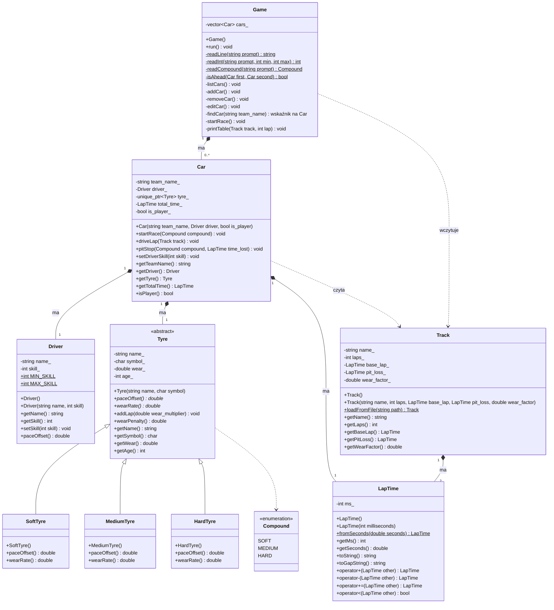

# Diagram klas PitWall

Diagram UML w składni Mermaid (GitHub rysuje go sam). Obrazek: [uml.png](uml.png).

Oznaczenia: `+` public, `-` private, kursywa = metoda czysto wirtualna,
podkreślenie = metoda statyczna, pełny romb = kompozycja (właściciel),
pusty grot = dziedziczenie,
przerywana strzałka = zależność. Operator `<<` dla `LapTime` jest
zwykłą funkcją poza klasą.

